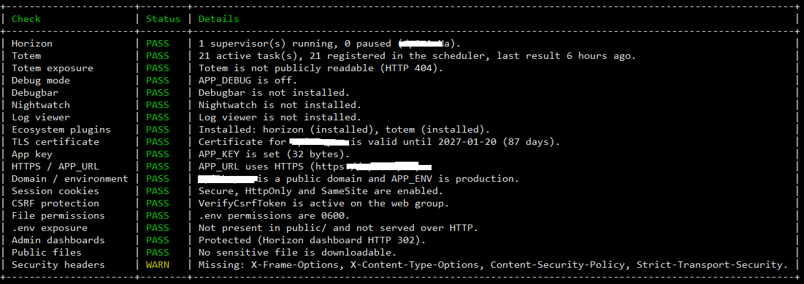

# SanityCheck

[](https://packagist.org/packages/bluedot-bd/sanity-check)
[](https://packagist.org/packages/bluedot-bd/sanity-check)
[](https://packagist.org/packages/bluedot-bd/sanity-check)

Security sanity checks and a malicious payload filter for Laravel applications.



## Why SanityCheck?

We all know what a product should avoid: debug mode left on, an `.env` sitting in
the web root, a debugbar or log viewer anyone can open, an expired certificate, a
queue worker that quietly died, a dashboard that was `auth`-protected last month
and is not anymore.

And then life happens. A deploy copies the wrong file, a server gets rebuilt, a
package is re-enabled "just for a minute" while debugging an incident, the person
who knew about that one `.env` backup leaves the team. The config that was
correct six months ago is not correct today, and nobody finds out until a
customer, a crawler, or an attacker does. By then someone has to log into five
dashboards to figure out what broke.

SanityCheck exists so most of those checks run for you:

- basic payload filtering on the way in, with the rules in a config file,
- `php artisan sanity-check:run` (manually or from the scheduler) tells you what
  is off right now,
- failures go to mail, Slack, Discord or your own webhook, so you hear about it
  first,
- and the action you configured - maintenance mode, for example - happens
  without anyone being awake.

**It does not guarantee security.** It cannot review business logic,
authorisation rules, infrastructure, or a determined attacker. What it does is
catch the basic, boring, recurring faults - the ones that keep happening - so you
are not the one who finds out last.

Three capabilities, one config file:

1. **`MaliciousPayloadFilter` middleware** — rejects requests whose payload contains
   `eval`, `shell_exec`, `exec`, `system`, backticks, `$(...)`, stream wrappers,
   PHP tags and similar code-execution signatures (all pattern-driven).
2. **`sanity-check:run` command** — a scheduled self-check of the application's
   security posture (Horizon, Totem, publicly reachable Totem, Nightwatch,
   debug/debugbar, APP_KEY, HTTPS, domain vs. environment, session cookies, CSRF,
   TLS expiry, `.env` exposure, admin dashboards, log viewer, sensitive public
   files, ecosystem plugins and security headers). Failures can trigger
   notifications and actions such as enabling maintenance mode.
3. **`sanity-check:advisories` command** — sends the installed packages to the
   Packagist security advisories API and warns about the advisories that affect
   your versions; runs once a day.
4. **`sanity-check:npm-advisories` command** — does the same for the npm
   packages in `package-lock.json` / `package.json` via the npm registry advisory
   API; also runs once a day.

## Installation

```bash
composer require bluedot-bd/sanity-check
```

That is all that is required - Laravel package discovery registers
`BluedotBd\SanityCheck\SanityCheckServiceProvider` automatically.

Publish the config file to tune the checks, channels and actions:

```bash
php artisan vendor:publish --tag=sanity-check-config
```

- Packagist: <https://packagist.org/packages/bluedot-bd/sanity-check>
- Source: <https://github.com/bluedot-bd/sanity-check>

Requires PHP 8.2+ and Laravel 11, 12 or 13.

## Payload filter

The middleware is prepended to the global HTTP stack, so it runs before any
controller/session/database work:

```php
// config/sanity-check.php
'middleware' => [
    'enabled' => true,
    'global' => true,       // auto-register; false = add it to App\Http\Kernel yourself
    'block' => true,        // false = log only
    'methods' => ['GET', 'POST', 'PUT', 'PATCH', 'DELETE'],
    'except_paths' => [],   // e.g. ['totem/*']
    'status' => 403,
    'message' => 'Invalid request payload.',
    'log' => true,
    'ignored_keys' => ['password', 'password_confirmation'],
    'patterns' => [
        'php_code_execution' => '/(?<!\w)(?:eval|assert|shell_exec|exec|system)\s*\(/i',
        // add your own rules here
    ],
],
```

Blocked requests are logged with the method, URL, IP, offending field and the
matched rule — never the payload value itself.

## Checks

Run manually:

```bash
php artisan sanity-check:run
php artisan sanity-check:run --url=https://example.com --dry-run
php artisan sanity-check:run --only=env_exposure,dashboards --json
php artisan security:check          # command alias
```

| Key | What it checks |
| --- | --- |
| `horizon` | Horizon master supervisors exist and are not all paused |
| `totem` | Totem enabled, active tasks, tasks registered on the scheduler, latest `task_results.ran_at` |
| `totem_exposure` | Totem dashboard is readable without authentication — **triggers maintenance mode by default** |
| `debug` | `APP_DEBUG` is off outside local/testing |
| `debugbar` | Debugbar not enabled in production and `/_debugbar/open` not reachable |
| `nightwatch` | Nightwatch installed but disabled in production (monitoring gap) or missing `NIGHTWATCH_TOKEN` |
| `log_viewer` | `log-viewer` route not readable anonymously (`403`/`302`/`404` pass) |
| `plugins` | Inventory of Laravel ecosystem packages with the expected production state (`enabled` / `disabled` / `ignore`) |
| `ssl` | TLS certificate expiry — WARN 3 days before, FAIL once expired |
| `app_key` | `APP_KEY` present, not a placeholder, decodes to 16+ bytes |
| `https` | `APP_URL` uses HTTPS |
| `domain` | `APP_URL` looks like a real public domain while `APP_ENV` is not production (or production with a non-public host) |
| `session` | `secure`, `http_only`, `same_site` cookie flags |
| `csrf` | CSRF middleware (`PreventRequestForgery`, or the older `ValidateCsrfToken`/`VerifyCsrfToken`) is present in the `web` middleware group |
| `env_permissions` | `.env` is not world-readable (POSIX only) |
| `env_exposure` | No `.env*` in `public/` and `GET {url}/.env` does not return environment contents |
| `dashboards` | `/horizon` and `/telescope` are not anonymously readable (Totem has its own check) |
| `sensitive_files` | `.git/config`, old `.env` copies, logs, phpinfo, Ignition, composer.json |
| `security_headers` | `X-Frame-Options`/CSP, `nosniff`, CSP and HSTS on the homepage |

Every check can be disabled with `'enabled' => false` and remote probes can be
skipped per run with `--skip-remote` (or globally with `SANITY_CHECK_SKIP_REMOTE`).

### Dashboard URLs

Horizon and Totem are usually moved off `APP_URL` — each has its own domain and
URI, and the exposure checks probe the URL they are actually served from:

| Dashboard | Host read from | URI read from |
| --- | --- | --- |
| Horizon | `config('horizon.domain')` (`HORIZON_DOMAIN`) | `config('horizon.path')` (`HORIZON_PATH`) |
| Totem | `config('totem.allowed_hosts')` (`TOTEM_ALLOWED_HOSTS`), falling back to `config('app.admin_domain')` (`ADMIN_DOMAIN`) | `config('totem.web.route_prefix')` (`TOTEM_WEB_ROUTE_PREFIX`) |
| Telescope | `config('telescope.domain')` | `config('telescope.path')` |

A bare host, a full URL and a comma-separated list are all accepted; the first
host wins and the `APP_URL` scheme is reused. Without a configured domain the
probe uses `APP_URL`.

`checks.totem_exposure.path` / `checks.totem_exposure.domain` and each
`checks.dashboards.targets.*.path` / `.domain` are optional overrides — leave them
`null` and the values above are used:

```php
'totem_exposure' => [
    'enabled' => true,
    'path' => null,    // null = config('totem.web.route_prefix')
    'domain' => null,  // null = TOTEM_ALLOWED_HOSTS or ADMIN_DOMAIN
    'signature' => '~vendor/totem/css/app\.css|<title>\s*Totem~i',
],
```

### Ecosystem plugins

`checks.plugins.packages` maps a package to its expected production state:

```php
'plugins' => [
    'enabled' => true,
    'packages' => [
        'nightwatch' => ['class' => 'Laravel\Nightwatch\Nightwatch', 'config' => 'nightwatch.enabled', 'expect' => 'enabled'],
        'pulse' => ['class' => 'Laravel\Pulse\Pulse', 'config' => 'pulse.enabled', 'expect' => 'disabled'],
        'telescope' => ['class' => 'Laravel\Telescope\Telescope', 'config' => 'telescope.enabled', 'expect' => 'disabled'],
        'log-viewer' => ['class' => 'Opcodes\LogViewer\LogViewerServiceProvider', 'config' => 'log-viewer.enabled', 'expect' => 'disabled'],
        'debugbar' => ['class' => 'Barryvdh\Debugbar\ServiceProvider', 'config' => 'debugbar.enabled', 'expect' => 'disabled'],
    ],
],
```

`expect` is only enforced in production: `disabled` packages that are enabled fail
the check, `enabled` packages that are off only warn. Add any other package by its
service provider class and config key.

### TLS certificate

```php
'ssl' => [
    'enabled' => true,
    'warn_days' => env('SANITY_CHECK_SSL_WARN_DAYS', 3),
    'verify_peer' => env('SANITY_CHECK_SSL_VERIFY', true),
],
```

Reads the certificate over TLS (`openssl_x509_parse`) from `APP_URL`, warns
`warn_days` before expiry and fails once expired. `verify_peer` exists only for
self-signed environments you control.

### Domain vs. environment

`checks.domain` compares `APP_URL` with the application environment:

| `APP_URL` host | `APP_ENV` | Result |
| --- | --- | --- |
| real public domain | `production` | PASS |
| real public domain | anything else | **WARN** - a public domain is served with dev/staging settings |
| `localhost`, `*.test`, `*.local`, `*.example`, IP | `production` | **WARN** - production points at a non-public host |
| `localhost`, `*.test`, `*.local`, `*.example`, IP | anything else | PASS |

This is the classic "someone rebuilt the server and forgot `APP_ENV`" case: the
domain is real, customers are on it, but the app thinks it is local - so debug
pages, verbose errors and test mailers are live.

## Security advisories

`php artisan sanity-check:advisories` sends every installed package (read from
`vendor/composer/installed.json`, falling back to `composer.lock`) to
`https://packagist.org/api/security-advisories/?packages[]=vendor/package`, then
keeps only the advisories whose `affectedVersions` really match the installed
version:

```bash
php artisan sanity-check:advisories
php artisan sanity-check:advisories --json
php artisan sanity-check:advisories --ignore=PKSA-xxxx-xxxx-xxxx
php artisan sanity-check:advisories --no-notify
```

- exit code is non-zero when an advisory affects an installed package, so it also
  works as a CI or monitoring gate,
- findings are logged (`critical`, throttled to once an hour) and sent through the
  configured notification channels if `notifications.enabled` is on,
- when nothing is found and `notifications.heartbeat.enabled` is on, the clean run
  is announced anyway — see [Notifications](#notifications),
- packages are queried in batches (`batch_size`) to keep the URL short.

```php
'advisories' => [
    'url' => env('SANITY_CHECK_ADVISORIES_URL', 'https://packagist.org/api/security-advisories/'),
    'timeout' => 10,
    'batch_size' => 50,
    'include_dev' => env('SANITY_CHECK_ADVISORIES_INCLUDE_DEV', true),
    'ignore' => [], // PKSA ids accepted as known risk
],
```

It is scheduled **once a day** (03:00 by default):

```php
'schedule' => [
    'advisories_enabled' => env('SANITY_CHECK_ADVISORIES_SCHEDULE', true),
    'advisories_cron' => env('SANITY_CHECK_ADVISORIES_CRON', '0 3 * * *'),
],
```

## npm advisories

`php artisan sanity-check:npm-advisories` audits the front-end dependencies the
same way `npm audit` does, using
`https://registry.npmjs.org/-/npm/v1/security/advisories/bulk`:

```bash
php artisan sanity-check:npm-advisories
php artisan sanity-check:npm-advisories --json
php artisan sanity-check:npm-advisories --path=resources/js/package.json
php artisan sanity-check:npm-advisories --ignore=1106913
php artisan sanity-check:npm-advisories --no-notify
```

- reads `package-lock.json` (or `npm-shrinkwrap.json`) next to `package.json`, so
  transitive dependencies are covered; without a lock file it falls back to the
  `dependencies` / `devDependencies` ranges (approximate, lowest version),
- only reports advisories whose `vulnerable_versions` range matches the installed
  version, sorted by severity,
- exit code is non-zero when something is affected; findings are logged
  (`critical`, throttled) and sent through the notification channels.

```php
'npm_advisories' => [
    'url' => env('SANITY_CHECK_NPM_ADVISORIES_URL', 'https://registry.npmjs.org/-/npm/v1/security/advisories/bulk'),
    'path' => env('SANITY_CHECK_PACKAGE_JSON'), // defaults to base_path('package.json')
    'timeout' => 15,
    'batch_size' => 50,
    'include_dev' => env('SANITY_CHECK_NPM_INCLUDE_DEV', true),
    'severities' => ['critical', 'high', 'moderate', 'low'], // empty = all
    'ignore' => [], // advisory ids accepted as known risk
],
```

Scheduled **once a day** at 03:15 (15 minutes after the Composer scan):

```php
'schedule' => [
    'npm_advisories_enabled' => env('SANITY_CHECK_NPM_ADVISORIES_SCHEDULE', true),
    'npm_advisories_cron' => env('SANITY_CHECK_NPM_ADVISORIES_CRON', '15 3 * * *'),
],
```

## Notifications

Sent when a result matches `notifications.statuses` (default: `fail`). Identical
reports are throttled by `throttle_seconds` (default one hour). Nothing is sent
until `SANITY_CHECK_NOTIFY=true` **and** the individual channel is enabled.

```php
'notifications' => [
    'enabled' => env('SANITY_CHECK_NOTIFY', false),
    'heartbeat' => ['enabled' => env('SANITY_CHECK_HEARTBEAT', false)],
    'statuses' => ['fail'],
    'throttle_seconds' => env('SANITY_CHECK_NOTIFY_THROTTLE', 3600),
    'channels' => [
        'mail' => ['enabled' => env('SANITY_CHECK_MAIL', false), 'to' => ['ops@example.com'], 'subject' => env('SANITY_CHECK_MAIL_SUBJECT', 'SanityCheck security report')],
        'webhook' => ['enabled' => env('SANITY_CHECK_WEBHOOK', false), 'url' => env('SANITY_CHECK_WEBHOOK_URL'), 'headers' => []],
        'slack' => ['enabled' => env('SANITY_CHECK_SLACK', false), 'webhook_url' => env('SANITY_CHECK_SLACK_WEBHOOK'), 'channel' => env('SANITY_CHECK_SLACK_CHANNEL')],
        'discord' => ['enabled' => env('SANITY_CHECK_DISCORD', false), 'webhook_url' => env('SANITY_CHECK_DISCORD_WEBHOOK')],
    ],
],
```

`.env` — enable only the channels you actually have:

```dotenv
# Master switch: nothing is sent while this is false
SANITY_CHECK_NOTIFY=true
# Announce clean daily advisory runs too ("SanityCheck is alive")
SANITY_CHECK_HEARTBEAT=true
# Suppress repeats of an identical report, in seconds
SANITY_CHECK_NOTIFY_THROTTLE=3600

# E-mail. Uses your normal Laravel mailer, so MAIL_* must already work.
# SANITY_CHECK_MAIL_TO takes a comma-separated list.
SANITY_CHECK_MAIL=true
SANITY_CHECK_MAIL_TO=ops@example.com,oncall@example.com
SANITY_CHECK_MAIL_SUBJECT="SanityCheck security report"

# JSON webhook
SANITY_CHECK_WEBHOOK=true
SANITY_CHECK_WEBHOOK_URL=https://example.com/hooks/sanity-check

# Slack
SANITY_CHECK_SLACK=true
SANITY_CHECK_SLACK_WEBHOOK=<your-slack-incoming-webhook-url>
SANITY_CHECK_SLACK_CHANNEL=#sanity-check

# Discord
SANITY_CHECK_DISCORD=true
SANITY_CHECK_DISCORD_WEBHOOK=<your-discord-webhook-url>
```

Leave a channel's `SANITY_CHECK_*` flag out (or `false`) and it stays disabled
even when `SANITY_CHECK_NOTIFY=true`. After editing `.env`, re-run
`php artisan config:cache` if your deployment caches config.

### Heartbeat

`SANITY_CHECK_HEARTBEAT=true` also announces runs that found nothing, so a
silently healthy schedule can be told apart from one that stopped running. It
applies to the daily `sanity-check:advisories` run:

> SanityCheck on MyApp (production): daily check ran clean - no issues detected. SanityCheck is alive.

A heartbeat is never sent when the run has findings — a real report always wins —
and it is throttled by the same `throttle_seconds`, so repeated manual runs do not
spam the channel. The webhook payload carries `"heartbeat": true` and `"ok": true`
for machine consumers; Slack and Discord get an "All clear" block, and the mail
subject ends in `- all clear`.

Payloads: JSON (`webhook`), Slack `attachments`, Discord `embeds`, and a Mailable
with the full report. Each channel is isolated — one failing channel never blocks
the others.

## Actions

```php
'actions' => [
    'maintenance' => [
        'enabled' => env('SANITY_CHECK_MAINTENANCE', true),
        // Which failing check keys put the site into maintenance. '*' = any failure.
        // totem_exposure is included because Totem can run arbitrary artisan commands.
        'trigger_on' => ['env_exposure', 'totem_exposure', 'debug', 'debugbar'],
        'secret' => env('SANITY_CHECK_MAINTENANCE_SECRET'), // bypass URL
        'retry' => env('SANITY_CHECK_MAINTENANCE_RETRY'),
    ],
],
```

`--dry-run` reports what would happen without touching the maintenance state.
`--no-notify` skips notifications.

## Scheduling

Registered by the package when running in console:

```php
'schedule' => [
    'enabled' => env('SANITY_CHECK_SCHEDULE', true),
    'cron' => env('SANITY_CHECK_SCHEDULE_CRON', '*/5 * * * *'),
    'environments' => ['production'],
    'without_overlapping' => true,
    'run_in_background' => true,
],
```

## Tests

```bash
php artisan test --filter=SanityCheck
```

## Maintainers

Bluedot Technology Ltd. - [saiful@bluedot.ltd](mailto:saiful@bluedot.ltd)

Bugs and feature requests: <https://github.com/bluedot-bd/sanity-check/issues>

## License

MIT - see [LICENSE](LICENSE).
